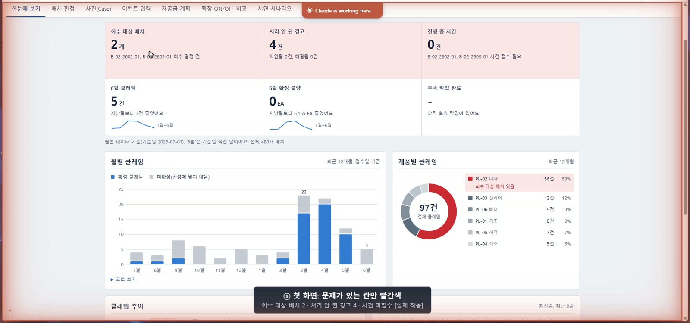
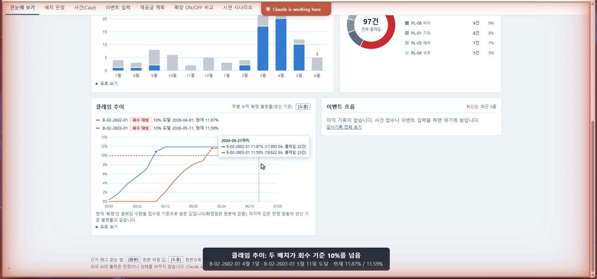
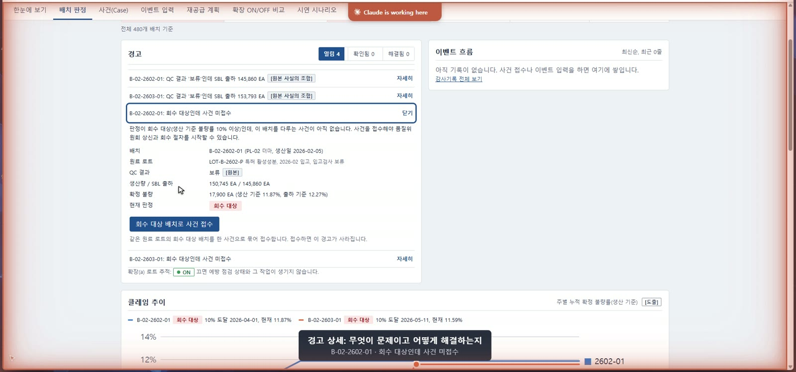
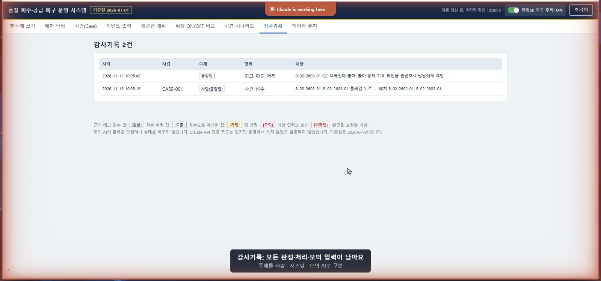
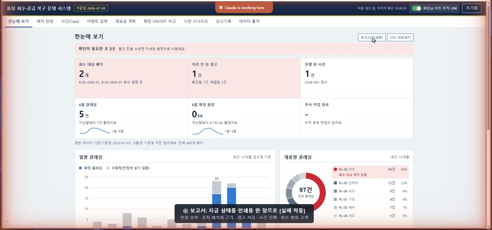
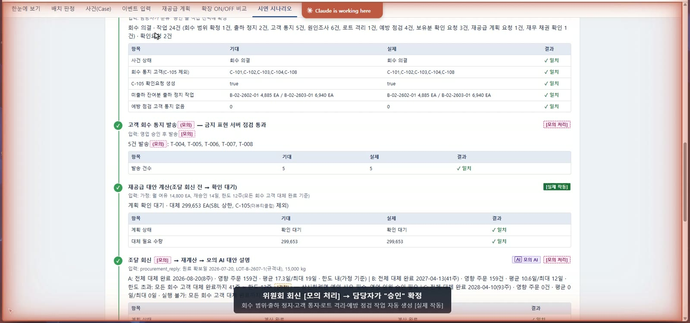
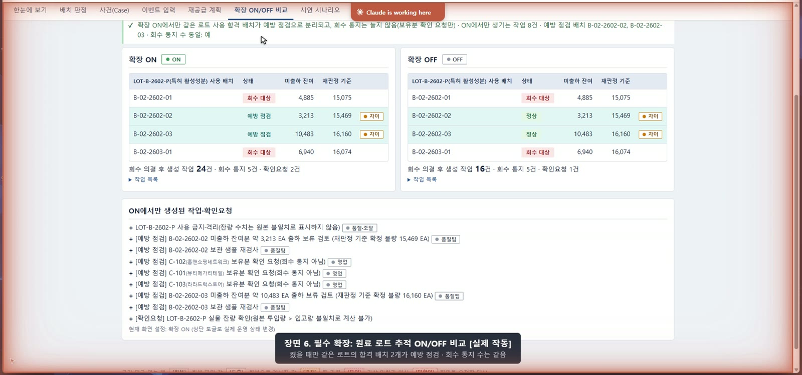

# 품질 회수·공급 복구 운영 시스템 (W03)

AX 인재전쟁 삼일PwC 출제 회차, **업무 3번 "품질 이슈와 공급 복구"** 를 풀며 만든 AI 기반 운영 시스템입니다.
클레임이 쌓였을 때 **어느 배치를 품질위원회에 회수 상신할지** 판단하고, 회수 의결 뒤 **영업·생산이 승인할 재공급 계획과 후속 작업**까지 이어 주는 웹앱입니다.

- 기준일: 2026-07-01 (대회가 제공한 가상기업 Corevia의 원본 데이터)
- 구성: Node.js 내장 `http` 서버 + 규칙 엔진 + 화면(바닐라 JS) + 모의 AI(규칙·템플릿, 비용 0원)
- 검증: 자동 테스트 85개(`npm test`), 세 가지 시나리오를 실제 API로 실행해 기대값·실제값 비교



---

## 목차
1. [이 시스템이 돕는 결정](#1-이-시스템이-돕는-결정)
2. [만든 순서 — 배포까지 무엇을 왜 만들었나](#2-만든-순서--배포까지-무엇을-왜-만들었나)
3. [화면별 기능과 만든 이유](#3-화면별-기능과-만든-이유)
4. [코드 구조](#4-코드-구조)
5. [작동 범위 — 실제 작동 · 모의 처리 · 설계](#5-작동-범위--실제-작동--모의-처리--설계)
6. [실행 방법](#6-실행-방법)

---

## 1. 이 시스템이 돕는 결정

**누가, 무엇을:** Corevia 품질팀이 클레임·검사 결과를 받았을 때
1. 어느 생산 배치를 품질위원회에 **회수 상신**할지
2. 위원회가 회수를 **의결**할지(사람이 결정, 시스템은 근거 정리)
3. 의결 뒤 영업 임원·생산이 어떤 **재공급 대안을 승인**할지

**왜 어려운가**
| 어려움 | 원본 데이터에서 확인한 사실 |
|---|---|
| 근거가 흩어져 있음 | 클레임은 품질, 출하처는 품질 출하(SBL), 매출은 매출 출하(SH)에 있고 SBL↔SH는 연결 키가 없음(정확 일치 0건) |
| 판정이 흔들림 | 정책은 "확정 불량 수량/배치 수량 10% 이상"인데 분모(생산량·출하량)에 따라 결과가 갈림. 미확정 클레임·언론 보도가 과잉 대응을 부름 |
| 회수와 공급 복구가 분리 | 더마 전용 라인 L-02 가동률 97% — 대체 물량은 다른 고객 주문을 밀어야 나옴 |
| 정정 뒤 책임 공백 | 판정이 바뀌면 이미 나간 통지·일정을 누가 다시 볼지 정해져 있지 않음 |

---

## 2. 만든 순서 — 배포까지 무엇을 왜 만들었나

커밋 기록 기준으로 단계를 나눴습니다. 각 단계는 "무엇을 만들었나 → 왜 만들었나" 순서입니다.

### 0단계 · 준비 (11/09)
- **만든 것:** AXHub 앱(`axwar-assignment`)을 만들고 배포 경로를 연결, 빈 앱으로 배포 테스트.
- **이유:** 결과물을 "실제로 돌아가는 배포된 앱"으로 내야 해서, 코드보다 배포 경로부터 확인했습니다.

### 1단계 · 분석 (11/11) — `docs/analysis/`
- **만든 것:** 영향 분석(`01_영향분석.md`)과 원인 조사(`02_원인조사.md`).
  - 480개 배치를 정책 산식으로 다시 계산해 회수 기준을 넘는 배치 2개(B-02-2602-01 11.87%, B-02-2603-01 11.59%)를 찾음
  - 두 배치가 입고검사 '보류'였던 원료 로트 LOT-B-2602-P를 썼고, 같은 로트를 쓴 합격 배치 2개가 약 30만 EA 출하된 사실 확인
  - 데이터 공백 정리: SBL↔SH 미연결, C-105 클레임의 출하 기록 없음, 캐파 기간 단위 불일치, 로트 투입량이 입고량보다 큼
- **이유:** 무엇을 자동화할지 정하기 전에, 원본 데이터만으로 확정할 수 있는 것과 없는 것(→ 확인요청·가정으로 처리)을 먼저 갈라야 했습니다.

### 2단계 · 설계 (11/11) — `docs/team/01_설계안.md`
- **만든 것:** 판정 규칙(회수 대상 / 분모 민감 / 예방 점검 / 조사·소명 / 정상), 사건(Case) 상태 흐름, 사람 승인 지점, 모의 처리 범위.
- **이유:** 대회 흐름도는 "의결 뒤 영업·생산이 수작업 확인"으로 끝납니다. 여기서 ① 추가자료 요구를 '보류 + 확인요청'으로 분리하고 ② 재공급 계획을 2단계 승인으로 붙이고 ③ 판정 정정 시 이전 의결 효력을 멈추도록 바꿨습니다. 품질위원회의 회수 권한은 그대로 뒀습니다.

### 3단계 · 1차 구현 (11/11) — 커밋 `837e77c`
| 만든 것 | 기능 | 만든 이유 |
|---|---|---|
| 원본 로더 `src/data.js` | 대회 CSV를 읽어 배치·클레임·출하·로트 모델 구성 | 원본을 고치지 않고(무수정 복사 + SHA-256 기록) 그대로 근거로 쓰기 위해 |
| 규칙 엔진 `src/rules.js` | 생산·출하 두 분모로 불량률 계산, 판정 상태 결정 | 정책 산식을 사람 손 계산 없이 매번 똑같이 적용하기 위해. 분모에 따라 갈리면 '분모 민감'으로 둘 다 상신 |
| 사건 흐름 `src/engine.js` | 접수 → 판정 → 상신 → 회신 확정 → 후속 작업 생성 → 재공급 → 정상화, 순서 위반 차단 | 회수와 공급 복구를 한 흐름으로 잇고, 판정 전 상신 같은 실수를 서버가 막기 위해 |
| 원료 로트 추적(필수 확장) | 같은 로트를 쓴 배치를 찾아 기준 미달이면 '예방 점검'으로 분리 | 배치 단위로는 안 보이는 위험 배치 2개를 잡되, 로트째 회수하는 과잉 대응은 피하기 위해 |
| 재공급 계획 `src/supply.js` | 대안 A/B/C 계산(완료 주수, 밀리는 기존 주문 수·지연일), 12주 한도 판정 | 생산 L-02 여력과 영업 납품 약속(다른 부서의 제약)이 대안 선택을 실제로 바꾸게 하기 위해 |
| 모의 AI `src/ai.js` | 근거 요약·상신문 초안, 회신 문장 분류 제안, 대안 설명·안내 초안 | 비용 0원으로 AI 역할을 보여 주되, 판정·상태는 AI가 못 바꾸고 사람이 확정하게 하기 위해 |
| 고객 통지 금지 표현 점검 | 원인 확정·보상 금액·미확정 납기·언론 보도 표현이 있으면 발송 차단 | 품질 정책상 미확정 내용을 고객에게 단정하면 안 되기 때문에 |
| 시나리오 실행기 `src/scenarios.js` | 정상·조건 변경·정보 부족 세 사례를 실제 API로 한 단계씩 실행하고 기대값과 비교 | "준비한 화면을 보여 주는 것"이 아니라 실제 처리 증거를 남기기 위해 |
| 확장 ON/OFF 비교 `src/compare.js` | 같은 입력을 확장 켬/끔 두 상태에서 실제 실행해 비교(작업 24건 대 16건, 회수 통지 수는 같음) | 확장이 정말 처리 결과를 바꾸는지 숫자로 증명하기 위해 |
| 감사기록·데이터 출처 화면 | 모든 처리와 모의 입력을 주체(사람·시스템·모의 AI)와 함께 기록, 원본 파일 목록·가정값 표시 | 누가 언제 무엇을 했는지 추적하고, 원본·도출·가정을 구분해 보여 주기 위해 |

### 4단계 · 검수와 수정 F1~F24 (11/11) — `docs/review/`, `docs/team/03_수정목록.md`
독립 검수자 두 명(요구사항 흐름 A, 엔지니어링 B) 관점으로 네 차례 검수하고 24건을 고쳤습니다. 대표적인 것:
- **통제 구멍:** 위원회 거절 뒤에도 통지 발송이 가능하던 문제(F1), 판정 변경 중 회신 한 번에 계획이 '완료'로 돌아가던 문제(F2) → 상태별로 막음
- **모의 AI 오판:** "승인 불가·부결·미의결"을 '승인'으로 제안하던 문제(F3, F20) → 부정 표현 우선, 화면에서 미리 선택하지 않음
- **입력 검증:** 잘못된 날짜·수량이 상태를 오염시키던 문제(F5), 잘못 인코딩된 주소 하나로 서버가 죽던 문제(F18) → 검증 실패 시 요청 전 상태로 되돌림
- **동시성:** 실패한 요청의 되돌리기가 다른 성공 요청까지 지우던 문제(F23) → 상태 변경 요청을 한 줄로 처리
- **이유:** 시연이 잘 되는 것보다, 예상 밖 입력·순서에서도 업무 규칙이 지켜지는 것이 운영 시스템의 핵심이라서입니다. 수정마다 재현 테스트를 추가했습니다.

### 5단계 · 디자인 정리 (11/11~11/12) — `docs/design/`
- **만든 것:** 판정 칩·근거 태그([원본]/[도출]/[가정]/[모의]) 체계, 사건 흐름 시각화, 대안 카드, 반응형·접근성. 시안 3종을 비교해 '신뢰 네이비(A안)'를 기본으로 적용. 브라우저 팝업 대신 화면 안 확인 상자.
- **이유:** 심사위원·실무자가 "판정 → 근거 → 승인 → 작업·상태 갱신"과 실제/모의 구분을 한눈에 읽게 하기 위해. 장식 기호와 색 테두리는 걷어 내고, **처리할 칸만 연한 빨강**으로 강조하는 규칙으로 통일했습니다.

### 6단계 · 경고 처리 (11/12)
- **만든 것:** 경고를 누르면 상세(배치·원료 로트·불량률·현재 판정)와 해결 방법이 나오고, 해결하면 사라지는 기능. 사건 미접수 경고는 사건을 접수하면 자동 해결, 'QC 보류인데 출하' 경고는 원본 사실이라 지우지 않고 확인 내용을 남겨 '확인됨'으로.
- **이유:** 경고가 "알림"에 그치지 않고 처리까지 이어져야 운영 화면이 되기 때문입니다.

### 7단계 · 운영 감시 화면 1~5단계 (11/12) — `docs/design/운영감시_화면구성안.md`
네트워크 장비(방화벽) 관리 화면처럼 실시간으로 상태를 지켜보는 화면을 참고했습니다.
| 단계 | 만든 것 | 이유 |
|---|---|---|
| 1~2 | 5초 자동 갱신(변경 번호 비교, 입력 중에는 덮어쓰지 않고 안내만), 경고 상태 열림/확인됨/해결됨과 처리 이력 | 다른 사람이 처리한 결과가 바로 보이되, 입력 중인 글은 지키기 위해 |
| 3 | 이벤트 흐름(감사기록 최신순, 같은 순간 반복은 한 줄로 묶음, 차단·재검증 같은 문제 신호만 강조) | 무슨 일이 막 일어났는지 한 칸에서 보기 위해 |
| 4 | 판정 칸을 누르면 배치 목록 거르기, 규칙 적중 현황 | 숫자에서 바로 해당 배치로 들어가기 위해 |
| 5 | 문제 배치의 주별 누적 불량률 추이(10% 기준선, 도달 시점, 표로 보기) | "언제부터 기준을 넘었나"를 근거로 보여 주기 위해 |

### 8단계 · 읽기 쉬운 화면으로 정리 (11/12)
- **만든 것:** 화면에서 규칙 번호(J1~J8)·비용 문구·부제·안내 띠 제거, 원본 번호 옆에 한글 이름 표시(예: `PL-02 더마`, `C-101 뷰티메가리테일`, `LOT-B-2602-P 특허 활성성분, 2026-02 입고, 입고검사 보류`).
- **이유:** 실무자는 규칙 번호로 일하지 않고, 번호만으로는 무엇인지 알 수 없어서입니다. 원본 번호는 추적용 열쇠라 그대로 두고 뜻만 붙였습니다.

### 9단계 · 보고서 내보내기 (11/12) — `src/report.js`
- **만든 것:** 현재 상태를 인쇄용 한 장(판정 요약·조치 배치와 근거·경고 처리·사건 진행·회수 범위 고객)과 전체 480개 배치 CSV(엑셀 한글 대응, 수식 주입 방지)로 내보내기.
- **이유:** 실무자가 가장 먼저 찾는 기능이 "위원회·상사에게 넘길 자료"이기 때문입니다. 읽기 전용이라 상태를 바꾸지 않습니다.

### 10단계 · 첫 화면 '한눈에 보기' (11/13) — `src/overview.js`
- **만든 것:** 누구나 배우지 않고 읽는 첫 화면.
  - 칸 6개(회수 대상 배치·처리 안 된 경고·진행 중 사건·이번 달 클레임·확정 불량·후속 작업 완료). **평소엔 흰 칸, 문제일 때만 빨간 칸**, 누르면 실무자용 상세 화면으로 이동
  - 지난달 대비는 기호 없이 문장으로("지난달보다 7건 줄었어요"), 칸 안에 최근 6개월 추이선·작업 진행 막대
  - 월별 클레임(확정/미확정 구분), 제품별 클레임 도넛(문제 제품만 빨강), 마우스를 올리면 숫자
  - 기존 대시보드는 '배치 판정' 상세 화면으로
- **이유:** 신입이든 다른 부서든 "지금 문제가 있나, 늘고 있나 줄고 있나"를 첫눈에 알 수 있어야 하고, 처리는 상세 화면에서 하도록 역할을 나누기 위해서입니다. 별도 브랜치에서 만들어 기존 화면과 나란히 비교한 뒤 채택했습니다.

### 11단계 · 배포 (11/13)
- 테스트 85개 통과를 확인하고 AXHub로 배포(`git push` → 자동 배포). 배포 후 실제 사이트에서 첫 화면·경고·보고서가 응답하는지 확인했습니다.

---

## 3. 화면별 기능과 만든 이유

| 화면(탭) | 기능 | 만든 이유 |
|---|---|---|
| 한눈에 보기 | 문제 칸만 빨간 칸, 월별·제품별 클레임, 추이, 최근 이벤트, 보고서 버튼 | 누구나 첫눈에 문제 유무와 추세를 파악 |
| 배치 판정 | 판정 칸 거르기, 경고 상세·처리, 이벤트 흐름, 규칙 적중, 배치 목록·상세 | 실무자가 판정 근거를 확인하고 경고를 처리 |
| 사건(Case) | 단계 진행 표시, 상신·회신 확정, 작업·확인요청, 사건 기록 | 회수 결정부터 정상화까지 한 사건으로 관리 |
| 이벤트 입력 | 판정 정정·언론 보도·회신 등 새 사건 입력 | 조건이 바뀌면 판단·계획을 다시 검증 |
| 재공급 계획 | 대안 A/B/C 계산·비교, 예외 사유, 2단계 승인 | 생산 여력·영업 약속을 반영한 공급 복구 |
| 확장 ON/OFF 비교 | 같은 입력을 확장 켬/끔으로 실제 실행해 비교 | 필수 확장이 처리 결과를 바꾸는 증거 |
| 시연 시나리오 | 세 사례를 단계별 실행, 기대값·실제값 표 | 재현 가능한 실행 증거 |
| 감사기록 | 모든 처리·모의 입력 기록(주체 구분) | 추적성 |
| 데이터 출처 | 원본 파일·해시, 도출·가정 값, 구현 구분 | 근거의 출처와 가정을 투명하게 |

<details><summary>화면 사진 더 보기</summary>

| | |
|---|---|
|  |  |
|  |  |
|  |  |

</details>

---

## 4. 코드 구조

```
server.js            내장 http 서버 — API, 상태 변경 직렬화·실패 시 되돌리기, 정적 파일
src/
  data.js            원본 CSV 로드·모델 구성(배치·클레임·출하·로트·고객·캐파)
  rules.js           불량률·판정 규칙(두 분모, 분모 민감, 미확정 제외)
  engine.js          사건 상태 흐름, 작업·확인요청 생성·재검증, 경고·이벤트 흐름·추이
  supply.js          재공급 대안 A/B/C 계산·한도 판정
  ai.js              모의 AI(운영) + Claude API 경로(미사용·미검증, 두 환경변수가 모두 있을 때만 열림)
  scenarios.js       시연 시나리오 3종 실행기(기대값 비교)
  compare.js         확장 ON/OFF 실제 실행 비교
  overview.js        첫 화면 요약 값(문제 칸 판정, 월별·제품별 클레임)
  report.js          보고서 내보내기(인쇄용 HTML·CSV)
  store.js           상태 저장·변경 번호(자동 갱신용)
public/              화면(index.html, app.js, style.css, themes/theme-a.css)
test/                node:test 85개(규칙, 상태 흐름, 검수 수정 재현, 경고·첫 화면, 보고서)
docs/                분석·설계·검수·디자인·제출 문서
```

외부 프레임워크 없이 Node.js 기본 기능으로 만들었습니다. 의존성은 `@anthropic-ai/sdk`·`zod`(미사용 경로용) 두 개뿐입니다.

---

## 5. 작동 범위 — 실제 작동 · 모의 처리 · 설계

| 구분 | 내용 |
|---|---|
| **실제 작동** | 원본 로드, 규칙 판정·재계산, 로트 추적·예방 점검, 사건 상태 전이와 순서 통제, 작업·확인요청 생성과 재검증, 재공급 대안 계산·한도 판정, 입력 검증, 감사기록, 금지 표현 점검, 첫 화면·경고 처리·보고서 |
| **모의 처리** | 품질위원회 회신, 영업 임원·생산 승인, 조달·고객 회신, 판정 정정 입력, 통지 발송(실제 발송 없음) |
| **설계 단계** | ERP·메일 연동, 원인조사 결론 |
| **AI** | 규칙·템플릿 모의 AI로 고정(비용 0원). 초안·제안만 만들고 판정·상태는 바꾸지 못함 |
| **사람 승인** | 상신(품질팀) · 회수 의결(품질위원회) · 회신 분류 확정(담당자) · 재공급 대안 승인(영업 임원·생산) · 초안 적용·발송(담당자) |

---

## 6. 실행 방법

```bash
npm ci
npm test     # 테스트 85개
npm start    # http://localhost:3000
```

> **원본 데이터는 이 저장소에 없습니다.** 대회가 제공한 원본 CSV는 재배포하지 않았습니다. 실행하려면 대회 원본 데이터를 `data/source/`에 같은 폴더 구조(`00_common`, `01_corevia`, `02_masil`, `05_external`)로 넣어야 합니다. 필요한 파일 목록과 SHA-256은 [data/source/README.md](data/source/README.md)에 있습니다.

자세한 실행·환경변수 안내는 [docs/RUN.md](docs/RUN.md), 설계 설명 7문항은 [docs/submission/설계설명_초안.md](docs/submission/설계설명_초안.md), 프로젝트 포트폴리오는 [docs/submission/portfolio/W03_포트폴리오.pdf](docs/submission/portfolio/W03_포트폴리오.pdf)에 있습니다.
